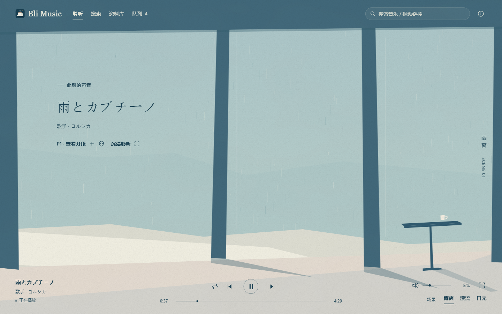
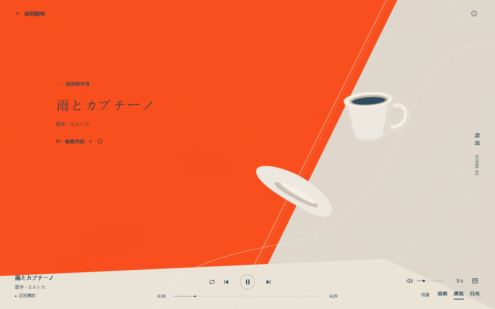
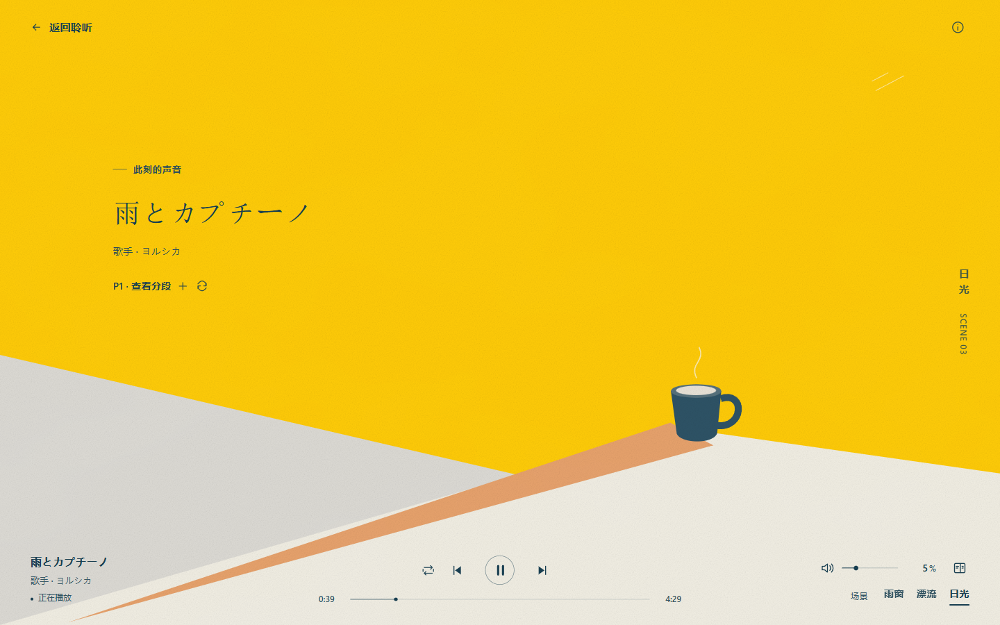
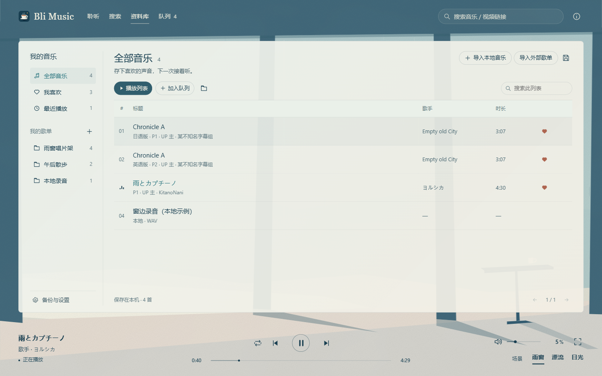
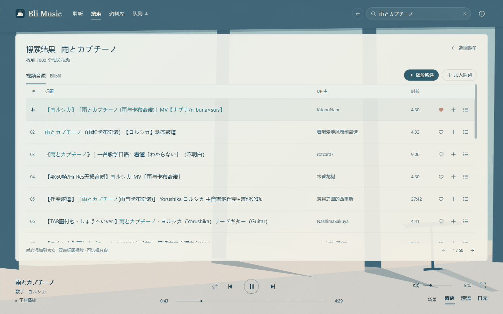
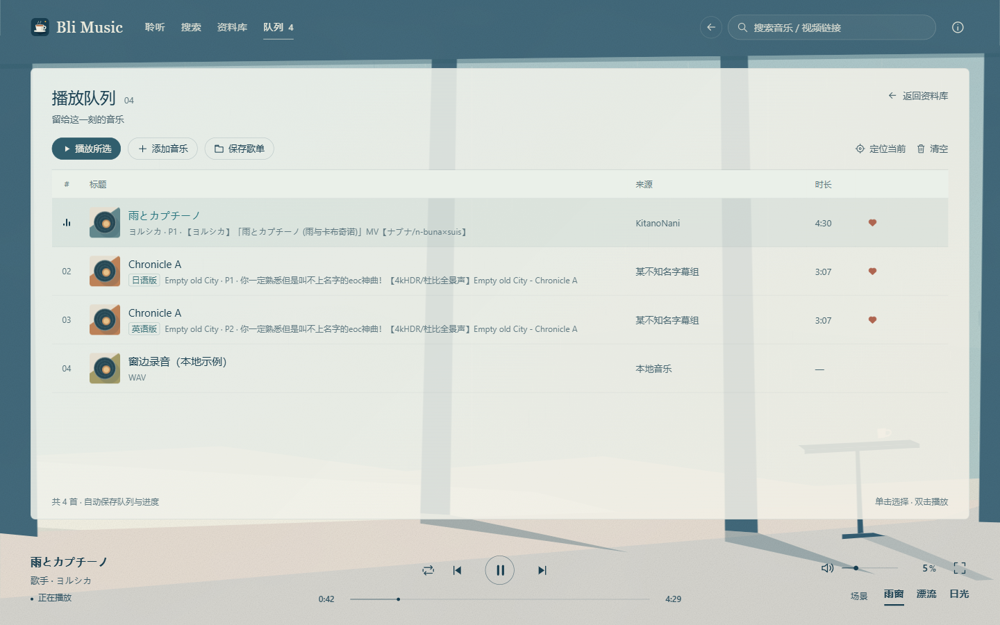

<p align="center">
  
</p>

# Bli Music

一款 Windows 音乐播放器，播放本地文件与 Bilibili 公开音源。用本地歌单、喜欢和播放队列整理音乐，配合雨窗、漂流、日光三套纸感场景。

**Windows 10/11 x64 · v0.5.0 · MIT**

[下载 Windows 安装包](https://github.com/IniJyou/Bli_music/releases/download/v0.5.0/Bli-Music-0.5.0-win-x64-setup.exe) · [查看 Release](https://github.com/IniJyou/Bli_music/releases/latest) · [安装与迁移说明](docs/windows_release.md)



## 页面展示

漂流和日光场景可切换到沉浸播放。切换页面时共用同一个播放器。

| 漂流 | 日光 |
| --- | --- |
|  |  |

资料库集中管理喜欢、历史和本地歌单，也提供本地音乐与外部歌单导入入口。



<details>
<summary>查看搜索与播放队列</summary>

关键词、BV/AV 和视频链接统一显示在主区域，搜索结果可直接喜欢、播放或加入队列。



队列支持混排本地音乐与 B 站音源，分 P 的语言版本单独显示。



</details>

截图来自 0.5.0 的独立演示资料库，包含手动整理的曲目信息和本地示例。搜索页面使用真实公开接口。

## 功能

| 功能 | 使用方式 |
| --- | --- |
| 在线搜索 | 搜索歌名、歌手，解析 BV/AV、B 站视频链接和 b23.tv 短链，选择多分 P |
| 本地音乐 | 多选导入 MP3、FLAC、WAV、M4A、AAC、OGG、OGA、Opus、WebM，与在线曲目混排 |
| 本地资料库 | 歌单、喜欢、最近播放、歌单内搜索，编辑展示歌名和歌手 |
| 外部歌单 | 导入公开网易云、QQ 音乐歌单，每次最多 500 首，匹配 B 站候选并试听、纠正、跳过 |
| 播放控制 | 顺序、列表循环、单曲循环、随机，队列排序、拖动进度、错误跳过 |
| 音量与响度 | 默认音量 5%，百分比输入和 0.1% 微调，可选响度均衡 |
| 恢复与备份 | 保存队列、进度、模式和场景，重启默认暂停，JSON 导入导出和 SQLite 备份 |
| 桌面集成 | 咖啡杯图标、托盘菜单、可选关闭窗口收起托盘，Windows 系统媒体控制 |

自动匹配最多三路查询，相同搜索词合并处理。停止后可继续匹配待处理和失败曲目，保存时复用已查询的视频信息。真实歌单的提速测量见 [P4 验证记录](docs/p4_validation.md)。

## 安装和使用

1. 在 [Release](https://github.com/IniJyou/Bli_music/releases/latest) 下载 Windows x64 安装包，按向导选择安装位置。
2. 从桌面或开始菜单的咖啡杯图标打开 Bli Music。
3. 搜索音乐或导入本地文件，把喜欢的版本整理到自己的歌单。

0.5.0 安装包约 **99 MiB**，安装后的程序目录约 **311 MiB**。新安装、覆盖升级、重启续播、快捷方式及卸载后的数据保留已在本机实测。[完整验证记录](docs/p5_validation.md)

个人构建采用未签名的安装包，Windows 可能显示“未知发布者”。[SHA-256 校验文件](https://github.com/IniJyou/Bli_music/releases/download/v0.5.0/SHA256SUMS.txt) 随版本发布。

## 数据与迁移

安装版默认使用以下目录。

- 资料库、备份与导出位于 `D:\BliMusicData\<Windows用户名>\data`。
- 缓存和日志位于 `D:\BliMusicData\<Windows用户名>\cache`。
- 没有 D 盘时，使用当前用户 AppData 下的 `BliMusic` 目录。

在「资料库 → 备份与设置」可查看路径、打开目录、创建备份和导入导出。高级用户可通过绝对目录环境变量 `BLI_MUSIC_HOME` 指定主目录。

从开发版升级时，先导出原资料库 JSON，再在安装版导入恢复。本地音乐需要重新选择原文件，以恢复读取权限并保留已有的编辑、喜欢与歌单信息。[详细迁移步骤](docs/windows_release.md)

本地音乐引用原文件，移动后需恢复原路径或重新导入。覆盖安装和卸载会保留独立的数据目录。

## 音源与使用范围

在线音源使用 Bilibili 未登录可访问的视频。访问受限、无独立音轨、限流和网络错误会显示明确状态，候选歧义可由用户修正。首版跳过 B 站个人账号接入、收藏夹同步、歌词和译文。

视频标题、UP 主、歌单信息与音视频由各自来源提供。仓库和安装包包含播放器及原创界面素材，音乐和 MV 由使用时选定的来源提供。

## 源码运行与构建

开发环境使用 Windows x64、Node.js **24.16.0 或更高的 24.x** 和 PowerShell 7。技术栈为 Electron、React、TypeScript、electron-vite 和内置 SQLite。

将仓库放在 D 盘后，可使用现有安装脚本配置依赖、Electron 和下载缓存。

```powershell
pwsh -NoProfile -ExecutionPolicy Bypass -File .\scripts\install-p0.ps1
npm.cmd run dev
```

常用检查和打包命令如下。

```powershell
npm.cmd run typecheck
npm.cmd test
npm.cmd run build
npm.cmd run dist
```

`dist` 将 Windows 安装包和 `SHA256SUMS.txt` 输出到 `release`，首次打包会获取官方 NSIS 等构建工具。下载内容与路径见 [P5 下载清单](docs/p5_download_plan.md)。

已安装依赖后也可双击 `start.cmd`，它会复用有效构建，源码变化时自动重建。开发版资料库位于项目内 `.data`。桌面回归命令和测试条件见 [P5 验证记录](docs/p5_validation.md) 与 [P2 验证记录](docs/p2_validation.md)。

## 许可与项目资料

源码采用 [MIT 许可证](LICENSE)。咖啡杯图标、场景和纸纹素材为本项目自行实现。第三方组件声明见 [THIRD_PARTY_NOTICES.txt](THIRD_PARTY_NOTICES.txt)，Electron 的许可与 Chromium 声明随程序提供。

[项目计划](project_plan.md) · [协作规则](AGENTS.md) · [Windows 使用说明](docs/windows_release.md)

功能调研参考了 [BiliMusic](https://github.com/HanversionOvO/BiliMusic) 和 [BBPlayer](https://github.com/bbplayer-app/BBPlayer)。
